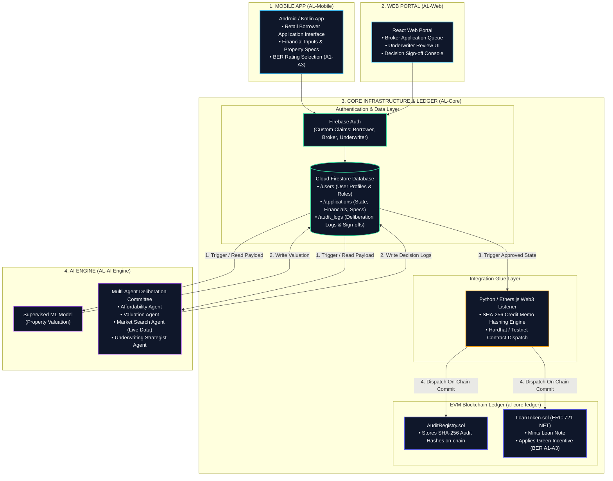

# Agentic Lender (AL): Decentralized & AI-Assisted Loan Underwriting Platform

**Agentic Lender (AL)** is an intelligent, end-to-end mortgage and loan underwriting platform designed to streamline origination, automate property appraisal, provide AI-assisted deliberation, and ensure tamper-proof notarization on a distributed ledger.

---

## 📌 Project Overview & Modules

The platform is structured into four core subsystems that cover the complete lifecycle of a loan:

1. **📱 Mobile Application (`AL-Mobile`)**
   - **Role:** Retail Borrower Interface.
   - **Tech Stack:** Android / Kotlin.
   - **Functionality:** Provides prospective borrowers with an intuitive mobile UI to apply for loans, submit personal and financial credentials, input property specifications, and specify Building Energy Ratings (BER A1–A3) to access green loan incentives.

2. **💻 Web Portal (`AL-Web`)**
   - **Role:** Broker & Underwriter Operations.
   - **Tech Stack:** React, Vite.
   - **Functionality:** Centralized portal for mortgage brokers to manage their application pipeline and for bank underwriters to review loan details, evaluate AI deliberation logs, and sign off on credit decisions.

3. **🧠 AI Engine (`AL-AI Engine`)**
   - **Role:** Automated Valuation & Deliberation Committee.
   - **Tech Stack:** Python, Supervised Machine Learning & Multi-Agent Systems.
   - **Functionality:** 
     - **Supervised ML Model:** Automated Valuation Model (AVM) for objective property appraisal.
     - **Multi-Agent Deliberation Committee:** Orchestrates specialized agents (Affordability Agent, Valuation Agent, Market Search Agent with live data, and Underwriting Strategist Agent) to assess borrower affordability, stress-test risk profiles, and generate comprehensive credit memos.

4. **⛓️ Core Infrastructure & Ledger (`AL-Core` / `al-core-ledger`)**
   - **Role:** Centralized Data Layer, RBAC & Blockchain Settlement.
   - **Tech Stack:** Firebase Auth, Cloud Firestore, Node.js, Hardhat, Python / Ethers.js, Solidity.
   - **Functionality:**
     - **Authentication & RBAC:** Firebase Authentication with custom claims (`borrower`, `broker`, `underwriter`).
     - **Database Layer:** Cloud Firestore maintaining stateful application records, user profiles, and audit trails.
     - **Integration Glue Layer:** Python and Ethers.js listeners that calculate SHA-256 hashes of approved credit memos and coordinate blockchain dispatches.
     - **EVM Blockchain Ledger:** Ethereum-compatible smart contracts (`AuditRegistry.sol` for immutable audit logging and `LoanToken.sol` ERC-721 NFT for loan tokenization with green incentives).

---

## 🏗️ System Architecture & Workflow

Below is the technical overview and flowchart detailing module interactions, data flows, and subsystem boundaries:

### 🔄 End-to-End Execution Flow

1. **Application Intake:** The borrower (via `AL-Mobile`) or broker (via `AL-Web`) authenticates through Firebase Auth and submits the mortgage application to Cloud Firestore.
2. **AI Valuation & Risk Deliberation:** Firestore events trigger the `AL-AI Engine`. The supervised ML model estimates property valuation, while the Multi-Agent Deliberation Committee stress-tests affordability and risk, storing valuation reports and decision logs back into Firestore.
3. **Underwriter Review & Sign-Off:** Human underwriters inspect the consolidated dossier and AI deliberations via `AL-Web` to finalize and sign off on the approval state.
4. **On-Chain Commit & Tokenization:** Transitioning to `Approved` triggers the Integration Glue Layer. The listener hashes the final credit memo with SHA-256 and coordinates transaction dispatch to the EVM Ledger, recording audit proofs in `AuditRegistry.sol` and minting the loan token note in `LoanToken.sol` (with green discounts applied for BER A1–A3 properties).
