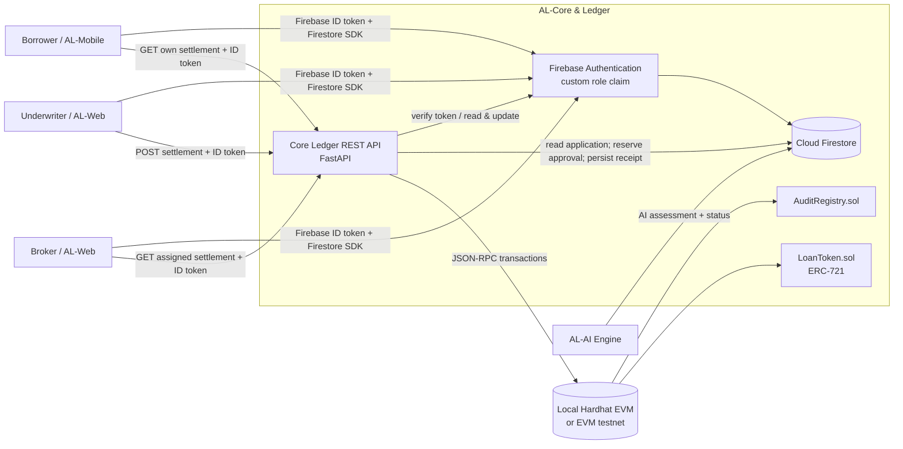
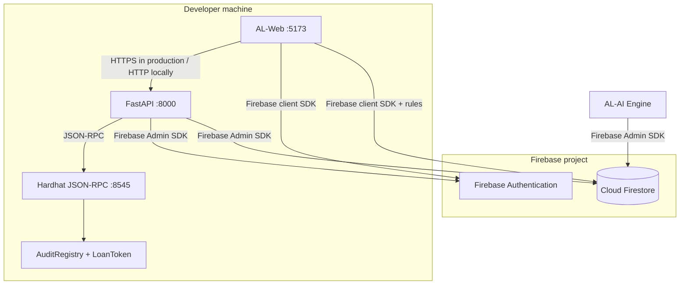

# AL-Core & Ledger Architecture

## Context and subsystem boundaries



Mobile and web clients use Firebase Authentication and Firestore for application
intake and role-scoped reads. The underwriter portal calls the Core API for the
approval-to-ledger action; it must not write an approval or a transaction result
directly to Firestore. The AI service writes its assessment and changes the
application to `AI_DELIBERATED` using its trusted server-side Firebase Admin
credential. Firebase Admin credentials never go into a browser or mobile app.

## Approval and settlement sequence

```mermaid
sequenceDiagram
    actor U as Underwriter (AL-Web)
    participant F as Firebase Auth
    participant A as Core Ledger API
    participant D as Firestore
    participant R as AuditRegistry
    participant L as LoanToken

    U->>F: Sign in; obtain Firebase ID token with role=underwriter
    U->>A: POST /v1/applications/{id}/settlement
    A->>F: Verify token and role
    A->>D: Read application and require AI_DELIBERATED
    A->>D: Transactionally reserve approval (PENDING)
    A->>A: Canonical JSON + SHA-256; HMAC borrower pseudonym
    A->>R: recordAuditHash(applicationIdHash, auditHash)
    R-->>A: Confirmed audit transaction
    A->>L: mintLoanToken(...)
    Note over L: A1/A2/A3 reduce APR by 25 bps
    L-->>A: Confirmed ERC-721 mint
    A->>D: Save transaction hashes, token ID and CONFIRMED status
    A-->>U: Audit hash, transaction hashes, chain ID and token ID
```

If a request is retried with the same application and approval payload, the API
checks the existing on-chain audit record and token before submitting anything
again. If audit recording succeeds but minting fails, the same request can
resume at minting. A different payload for an already-approved application
returns `409 Conflict`.

## Data ownership and privacy

| Data | System of record | On-chain? |
|---|---|---|
| User profile, role profile, application documents and AI assessment | Firestore | No |
| Credit memo and valuation included in the settlement request | API memory for hashing; upstream assessment remains in Firestore | No plaintext |
| Canonical SHA-256 of approval, memo, valuation and loan terms | Firestore transaction metadata and `AuditRegistry` | Yes |
| Principal (integer minor units), final APR (basis points), term, BER, borrower pseudonym | ERC-721 `LoanToken` | Yes |
| Application ID | Firestore document ID | Only its Keccak-256 hash |

EVM data is public. Do not send names, email addresses, account numbers, or
unhashed Firebase UIDs to either contract. The borrower hash is a keyed HMAC
derived by the API; it is a pseudonym, not encryption or a guarantee of
anonymity. Do not reuse the development hash secret in a deployed environment.

Money fields use integer minor currency units (for example, euro cents), never
floating-point amounts. APR values use basis points (`350` = `3.50%`).

## Deployment view



For a public EVM testnet, replace the local RPC URL and chain ID, provide a
dedicated signing key through a secret manager, deploy the contracts, and grant
the API signer `AUDITOR_ROLE` and `MINTER_ROLE`. Never use a Hardhat development
key on a public network.
